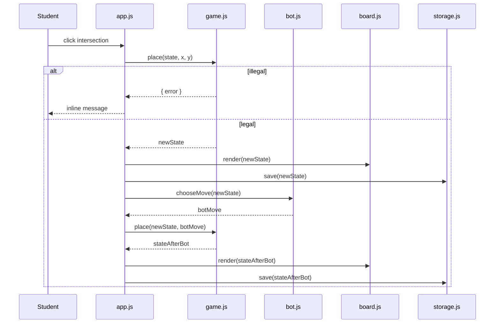

# Architecture — demo

## 1. Overview

demo is a **static, client-side web application**. Everything — rules, bot, scoring, and persistence — runs in the student's browser. There is no server-side code, database, authentication, or external API.

```
GitHub Pages (static hosting)
        │  HTTPS
        ▼
┌─────────────────────────────────────────────┐
│ Browser                                     │
│                                             │
│  index.html                                 │
│    ├── css/styles.css                       │
│    └── js/app.js  (UI controller)           │
│          ├── js/game.js     (rules engine)  │
│          ├── js/board.js    (renderer)      │
│          ├── js/bot.js      (opponent)      │
│          ├── js/scoring.js  (area score)    │
│          └── js/storage.js  (localStorage)  │
│                                             │
│  localStorage: one saved game               │
└─────────────────────────────────────────────┘
```

## 2. Why this shape

The product is a single-player learning aid with no shared state and no sensitive data. The template default (ASP.NET Core modular monolith, PostgreSQL, Entra ID, Azure Container Apps) exists to meet requirements that do not apply here: multi-user governance, roles, audit, and integrations.

Per the delivery template's own guidance — *choose the simplest reversible option and do not add infrastructure for hypothetical scale* — this project uses static hosting. The deviation is recorded in [ADR-0001](adr/0001-static-client-side-app.md).

## 3. Components

| Module | Responsibility | Depends on |
|---|---|---|
| `app.js` | Boot, wire DOM events, own view state (turn, thinking, result), call pure modules, drive rendering | all modules |
| `game.js` | Pure rules engine: place stone, capture, suicide, ko, pass, resign, undo, move history | none |
| `board.js` | Render board and stones (SVG preferred), highlight last move, focus ring | DOM only |
| `bot.js` | Pure move selection: enumerate legal moves, score them with simple heuristics, pick deterministically | `game.js` helpers |
| `scoring.js` | Pure area scoring at game end: stones + surrounded empty points, komi | `game.js` state |
| `storage.js` | Serialise/validate/restore the single saved game; guard against corrupt data | `localStorage` |

### 3.1 Module boundaries

- `game.js`, `bot.js`, and `scoring.js` **must not** import DOM, `window`, or `localStorage`. They are pure and tested in Node.
- `board.js` owns all SVG/canvas and focus management.
- `storage.js` is the only module allowed to touch `localStorage`.
- `app.js` is the only module allowed to touch `document` outside `board.js`.

## 4. Game state model

A single immutable-ish state object is passed around. Mutating operations return a new state (or a cloned state) so undo is reliable.

```
GameState {
  size: 9
  board: Array(81)            // null | 'B' | 'W'
  turn: 'B' | 'W'
  captures: { B: number, W: number }
  koPoint: { x, y } | null
  history: Move[]             // append-only
  passes: number              // consecutive passes
  status: 'playing' | 'scored' | 'resigned'
  result: Result | null
}

Move {
  index: number               // 0..80, or null for pass/resign
  color: 'B' | 'W'
  type: 'place' | 'pass' | 'resign'
  captured: number[]          // indices removed by this move
  boardBeforeHash: string     // for ko / superko checks
}
```

Full detail in `data-model.md`.

## 5. Rules engine flow

```
place(state, x, y)
  ├─ if status !== 'playing' → illegal('game over')
  ├─ if point occupied      → illegal('occupied')
  ├─ tentatively place stone
  ├─ remove adjacent opponent groups with 0 liberties
  ├─ if own group has 0 liberties and no capture → illegal('suicide')
  ├─ if resulting position equals previous position → illegal('ko')
  ├─ commit move, update captures, toggle turn, compute koPoint
  └─ return new state
```

Group liberty detection uses a flood fill over orthogonal neighbours. Board is small (81 points), so no optimisation is needed.

## 6. Bot design

The bot is intentionally simple, explainable, and deterministic.

1. Enumerate all legal moves (reuse the rules engine on a clone).
2. Score each candidate with weighted heuristics:
   - captures (highest weight),
   - saves own group in atari,
   - avoids self-atari,
   - prefers star points, corners, and third/fourth line early,
   - avoids filling own territory late,
   - small deterministic tie-breaker (e.g. distance to centre or seed derived from position).
3. Pick the highest-scoring move; if none, pass.

No time-based randomness. Determinism is required for tests (PR-21). The bot runs synchronously for the MVP; if measurement shows a stall, it moves to a `setTimeout`/`requestIdleCallback` wrapper with a "thinking" indicator (PR-23).

See [ADR-0002](adr/0002-client-side-heuristic-bot.md).

## 7. Scoring

Area scoring at game end:

1. Count stones of each colour on the board.
2. Flood-fill each empty region; if it borders exactly one colour, all its points belong to that colour (territory).
3. `blackScore = blackStones + blackTerritory`
   `whiteScore = whiteStones + whiteTerritory + komi(6.5)`
4. Winner is the higher score; ties are impossible with 6.5 komi.

No dead-stone removal or life-and-death resolution is implemented; the MVP assumes players mark the game over when they agree, or the bot/human resign. This limitation is documented and surfaced in the result panel.

## 8. Persistence

- One key: `demo:save:v1`.
- Value: JSON `{ version, state }`.
- On save: serialise state after every committed move.
- On load: parse, validate `version` and `size`, validate board length and values, validate turn; if anything fails, remove the key and start fresh.
- Never trust stored data; treat it as untrusted input.

See [ADR-0003](adr/0003-localstorage-persistence.md).

## 9. Rendering

- **SVG** board: 9×9 grid, star points, stones as circles with a subtle highlight.
- Each intersection is a focusable element (`<button>` or `tabindex` + role) with an accessible name like “Column C, row 7, empty”.
- Last move marked with a distinct ring.
- Responsive: board scales with viewport via `viewBox`; layout stacks controls under the board on narrow screens.
- No external fonts; use a system font stack.

## 10. Hosting and delivery

- Static files at repository root, served by GitHub Pages.
- No CI required to deploy, but CI runs tests and a link/asset check.
- Add `.nojekyll` so files beginning with `_` are served if introduced later.
- No build step; source is the deployable artifact.

## 11. Failure handling

| Failure | Behaviour |
|---|---|
| Illegal move | Inline, non-blocking message; state unchanged |
| Corrupt save | Discard silently, start new game |
| `localStorage` unavailable/quota | Play continues; saving disabled with a quiet notice |
| Bot finds no legal move | Bot passes |
| Both players pass | Game scores |
| JavaScript disabled | `<noscript>` explains the app requires JavaScript |
| Browser too old for ES modules | `<noscript>`/fallback notice |

## 12. Deviations from the delivery template

| Template default | demo | Reason |
|---|---|---|
| ASP.NET Core modular monolith | Static HTML/CSS/JS | No server-side requirements |
| PostgreSQL | None | No shared/persistent server data |
| Entra ID auth | None | No accounts or roles |
| Azure Container Apps | GitHub Pages | Static hosting is sufficient |
| Freshservice / Graph / Defender | None | No integrations |
| Bicep / Key Vault | None | No infrastructure or secrets |
| Workflow engine / audit service | None | Single-player game; move history is the audit trail |

The principles retained: simple architecture, deterministic behaviour, no secrets, least privilege, testability, and no unrelated scope.

## 13. Sequence: human move → bot reply


