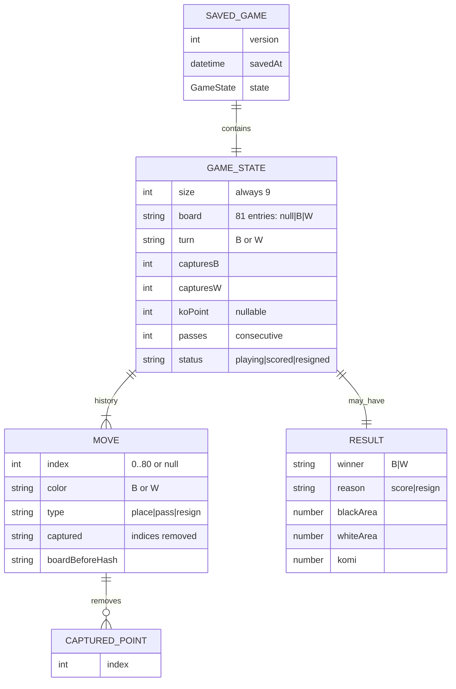

# Data Model — demo

There is **no database**. This document describes the in-memory game state and the shape of the single `localStorage` record. It is the contract for `game.js`, `bot.js`, `scoring.js`, and `storage.js`.

## 1. Entity overview



## 2. Type definitions

Reference implementation types (JSDoc/TypeScript-style, not a build requirement):

```ts
type Color = 'B' | 'W';
type Cell = Color | null;
type Point = { x: number; y: number };

type MoveType = 'place' | 'pass' | 'resign';

interface Move {
  index: number | null;       // 0..80 for place; null otherwise
  color: Color;
  type: MoveType;
  captured: number[];         // board indices removed by this move
  boardBeforeHash: string;    // hash of position before the move
}

interface GameState {
  size: 9;
  board: Cell[];              // length 81
  turn: Color;
  captures: { B: number; W: number };
  koPoint: Point | null;
  history: Move[];
  passes: number;             // consecutive passes
  status: 'playing' | 'scored' | 'resigned';
  result: Result | null;
}

interface Result {
  winner: Color;
  reason: 'score' | 'resign';
  blackArea: number;          // stones + territory
  whiteArea: number;          // stones + territory
  komi: number;               // 6.5
}

interface SavedGame {
  version: 1;
  savedAt: string;            // ISO 8601
  state: GameState;
}
```

## 3. Board indexing

- Flat array of `size * size = 81` cells.
- Index = `y * 9 + x`, where `x` is column (0–8, left→right) and `y` is row (0–8, top→bottom).
- Display columns skip `I`: `A B C D E F G H J` (9 columns; see assumption A-6).
- Star points (0-indexed): `(2,2)`, `(2,6)`, `(6,2)`, `(6,6)`, `(4,4)`.

## 4. Invariants

These must hold for any `GameState` produced by the engine:

1. `board.length === 81`.
2. Every board cell is `null`, `'B'`, or `'W'`.
3. `turn` is `'B'` or `'W'`.
4. `captures.B` and `captures.W` are non-negative integers.
5. `history` is append-only; existing entries are never mutated.
6. `history[i].color` alternates, except after the game ends.
7. `passes` equals the number of trailing consecutive `type === 'pass'` moves.
8. If `status !== 'playing'`, no further moves are accepted.
9. `koPoint` is `null` or a board index outside the range `[0, 80]` is never stored.
10. A board position may never immediately repeat the position before the last move (simple ko).

## 5. Serialisation schema (localStorage)

Key: `demo:save:v1`

```json
{
  "version": 1,
  "savedAt": "2026-11-05T12:00:00.000Z",
  "state": {
    "size": 9,
    "board": [null, "B", null, "W", null],
    "turn": "W",
    "captures": { "B": 0, "W": 1 },
    "koPoint": null,
    "history": [
      {
        "index": 40,
        "color": "B",
        "type": "place",
        "captured": [],
        "boardBeforeHash": "000000..."
      }
    ],
    "passes": 0,
    "status": "playing",
    "result": null
  }
}
```

(The example board is truncated for readability; real saves always contain 81 entries.)

### 5.1 Validation on load

`storage.load()` must reject and discard the record if any of the following is true:

- not valid JSON, or not an object;
- `version !== 1`;
- `state` missing or not an object;
- `state.size !== 9`;
- `state.board` not an array of length 81;
- any cell not in `{null, 'B', 'W'}`;
- `turn` not `'B'`/`'W'`;
- `captures` missing or values not non-negative integers;
- `history` not an array, or any move malformed;
- `status` not one of the allowed values;
- `passes` not a non-negative integer.

On rejection: remove the key and return `null`. No exception is surfaced to the user.

## 6. Hash function for ko

`boardBeforeHash` stores a compact string of the board for the immediately preceding position. A simple implementation is the 81-character string of `B`/`W`/`.` characters. It is only used for simple-ko detection (the position before the move), not full superko.

## 7. Retention

- The saved game persists until replaced by a new game, cleared by the user via browser settings, or discarded as invalid.
- No server-side retention exists.
- No personal data is stored.

## 8. Migration

- `version` is the schema version. Only version `1` is supported in the MVP.
- Future incompatible changes must increment `version` and either migrate or discard old saves. Discarding is acceptable because saves are non-sensitive and a fresh game is cheap.

## 9. Seed / demo data

None. The board starts empty. Any sample positions used in tests live in the test files as deterministic fixtures, not in production data.
